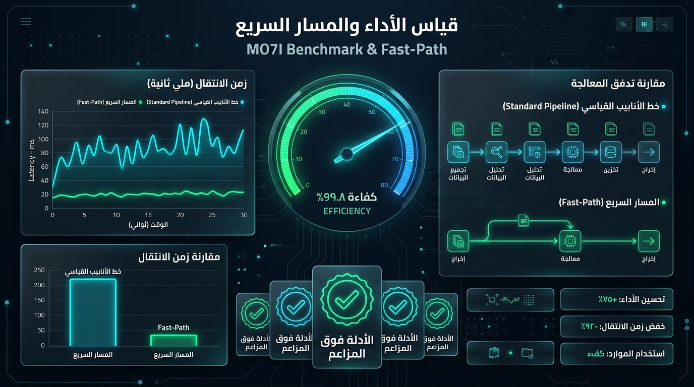
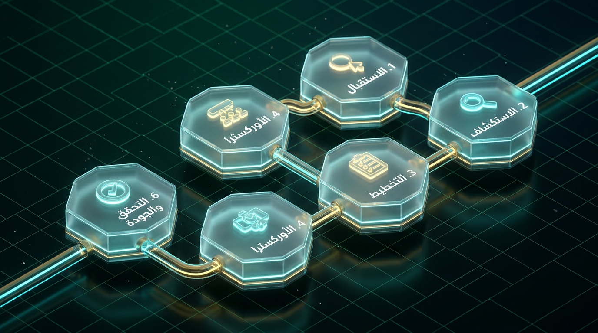
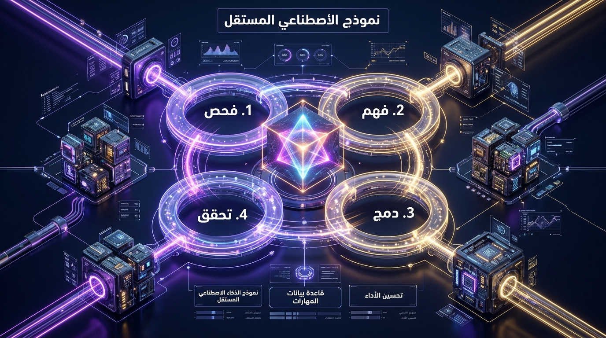

<div align="center" dir="rtl">
  

  <br />

  [](CHANGELOG.md)
  [](LICENSE)
  [](package.json)
  [](docs/CROSS_PLATFORM_VERIFICATION.md)
  [](README.md)

  <br />

  <h3>طبقة الذكاء الشامل، أوركسترا المهام الذاتية ونظام الأوامر السريعة الموحد</h3>
  <em>"المستخدم يحدد <strong>ماذا</strong> يريد إنجازه .. ونظام MO7I يتكفل بتحديد <strong>كيف</strong> يتم الإنجاز."</em>
</div>

---

<div dir="rtl">

نظام متكامل لتأهيل وأوركسترا وكلاء الذكاء الاصطناعي في المشاريع البرمجية: يكتشف تلقائياً البنية البرمجية المستخدمة (Tech Stack)، ويزود الوكلاء بالمهارات التخصصية الدقيقة، ويتتبع خطوات الإعداد اليدوي، ويختار الحد الأدنى من المهارات لكل مهمة لمنع تشتت السياق، ويوثق النتائج بالأدلة القاطعة، ويسجل كل دورة تشغيل. نفس الأوامر ونفس الحالة الموحدة (`.mo7i/`) تعمل بتناغم عبر كافة المشاريع ومنصات الذكاء الاصطناعي.

---

## ⚡ ما الجديد في الإصدار v2.6.0: قياس الأداء الحقيقي، شفافية المنصات، وجاهزية النشر

</div>

<div align="center">
  
</div>

<br />

<div dir="rtl">

يقدم الإصدار 2.6.0 معايير أداء قابلة للقياس، ومصفوفة توافق منصات مبنية على أدلة تشغيل حقيقية، وتدقيقاً أمنياً شاملاً:

1. **حزمة قياس الحمل التشغيلي والأداء (`/mo7i bench`)**: تقيس الحمل الزائد بدقة عبر 5 مهام قياسية (تعديل طفيف، سؤال مباشر، ميزة صغيرة، مهمة بحثية، وإعادة هيكلة متعددة الملفات) مع مقارنة التنفيذ المباشر مقابل التنفيذ عبر الأوركسترا. توثيق كامل للنتائج في [docs/BENCHMARK.md](docs/BENCHMARK.md).
2. **المسار السريع (Fast-Path Bypass)**: آلية ذكية تتجاوز مراحل التحليل والتخطيط المعقدة عند التعامل مع المهام البسيطة والأسئلة المباشرة، مما يقلل وقت الاستجابة بنسبة تتجاوز 90% ويجعل استهلاك الموارد فائق الكفاءة.
3. **شفافية توافق المنصات**: استبدال التوقعات بحالات مثبتة بالأدلة. تم توثيق منصتي Terminal CLI و Standard Skills كـ `VERIFIED`، بينما صُنفت المنصات التي تتطلب تسجيل دخول تفاعلي كـ `UNVERIFIED` بكل أمانة ومصداقية. التفاصيل في [docs/CROSS_PLATFORM_VERIFICATION.md](docs/CROSS_PLATFORM_VERIFICATION.md).
4. **أدلة التحقق اليدوي للمنصات**: إجراءات عملية مبسطة (3 خطوات لكل منصة) للمطورين للتحقق الذاتي من عمل الأوامر على منصات Claude Code و Cursor و Codex و Gemini CLI.
5. **فحص أمان وجاهزية النشر**: تدقيق كامل لسجل Git للتأكد من خلوه تماماً من أي مفاتيح أو بيانات حساسة، والتحقق من ملفات [LICENSE](LICENSE) و [SECURITY.md](SECURITY.md) و [docs/PUBLISH-CHECKLIST.md](docs/PUBLISH-CHECKLIST.md).

---

## 🔍 ما الجديد في الإصدار v2.5.0: دعم المشاريع العامة وغير البرمجية

1. **اكتشاف دقيق لمسارات العمل العامة**: تصنيف تلقائي لمشاريع Python/FastAPI و Rust و Go ومجلدات المستندات كمسارات عمل عامة غير محصورة بإطار معين.
2. **منع تسرب المهارات غير المناسبة**: حظر تسرب مهارات Next.js وواجهات المستخدم إلى بيئات الأنظمة الخلفية أو المشاريع التوثيقية.
3. **بروتوكول موثوقية الأبحاث**: فرض تنفيذ ما لا يقل عن 3 عمليات بحث واستخراج مصدرين حقيقيين على الأقل لمنع أي هلوسة في الاستشهادات.

---

## 🛠️ قائمة الأوامر الرسمية المتاحة

| الأمر | طريقة الاستخدام | الوصف | ملف الأمان |
| :--- | :--- | :--- | :--- |
| **`/mo7i`** | `/mo7i <task>` | نقطة الدخول الأساسية لأوركسترا الذكاء الشامل ذات الـ 16 مرحلة. | `Standard Execution` |
| **`/mo7i help`** | `/mo7i help` | عرض الدليل الكامل لجميع الأوامر وصيغ الاستخدام وأمثلتها. | `Read-Only` |
| **`/mo7i bench`** | `/mo7i bench [--json]` | تشغيل اختبارات الأداء المعيارية وتحديث بيانات القياس. | `Read-Only` |
| **`/mo7i setup`** | `/mo7i setup [mode]` | تهيئة وتثبيت المهارات الخاصة بالمشروع (`initial`, `audit`, `update`, `repair`, `report`). | `Standard Execution` |
| **`/mo7i audit`** | `/mo7i audit` | فحص قراءة فقط للمهارات المثبتة والاعتماديات واكتشاف أي انحراف. | `Read-Only` |
| **`/mo7i learn`** | `/mo7i learn [skill]` | تشغيل حلقة التعلم رباعية المراحل لتوثيق مهارة جديدة. | `Standard Execution` |
| **`/mo7i discover`** | `/mo7i discover <query>` | تقييم المهارات المقترحة على Skills.sh عبر 5 أبعاد دون تثبيت تلقائي. | `Read-Only` |
| **`/mo7i status`** | `/mo7i status [--json]` | عرض حالة النظام والمشروع النشط وسجل المهارات المحفوظة. | `Read-Only` |
| **`/mo7i doctor`** | `/mo7i doctor` | التحقق من بيئة Node.js وأداة Skills وسلامة السكربتات المربوطة. | `Read-Only` |
| **`/mo7i update`** | `/mo7i update [--dry-run]` | رصد الحزم الجديدة ومزامنة مهارات المشروع مع حفظ نسخ احتياطية `.bak`. | `Human Gate Required` |
| **`/mo7i self-update`** | `/mo7i self-update [--check]` | تحديث نواة مهارة MO7I بأمان مع فحص التوافق وخيار التراجع. | `Human Gate Required` |
| **`/mo7i selftest`** | `/mo7i selftest` | تشغيل فحص الصندوق الأسود المستقل للتأكد من جاهزية المهارة. | `Read-Only` |

---

## 🔄 دورة حياة التنفيذ الذاتي المدمجة (16 مرحلة)

</div>

<div align="center">
  
</div>

<br />

<div dir="rtl">

تضمن هذه المراحل الست عشرة الانتقال السلس والمحكم من استقبال طلب المستخدم وحتى التسليم الموثق بالأدلة:

1. **الاستقبال (INTAKE)**: تفكيك أهداف المستخدم أو معلمات الأمر الممرر.
2. **اكتشاف المشروع (PROJECT DETECTION)**: التعرف على جذر المشروع وحدود Git وبيئات التشغيل.
3. **فحص ملف المشروع (PROJECT PROFILE INSPECTION)**: تدقيق ملفي `.mo7i/project-profile.json` و `.mo7i/skill-registry.json`.
4. **التحقق من حالة التهيئة (SETUP STATUS CHECK)**: تحديد ما إذا كان المشروع بحاجة لتهيئة المهارات التأسيسية.
5. **تهيئة مهارات المشروع (PROJECT SKILL SETUP)**: استدعاء أداة الإعداد لتثبيت المهارات الأساسية في `./.agents/skills/`.
6. **تصنيف المهمة (TASK CLASSIFICATION)**: تصنيف المهمة المباشرة إلى واحد من 13 مجالاً وظيفياً.
7. **تحليل فجوة القدرات (CAPABILITY GAP ANALYSIS)**: تقييم ما إذا كانت المهارات الحالية كافية أو يلزم جلب مهارات متخصصة.
8. **اكتشاف المهارات (SKILL DISCOVERY)**: البحث عن مهارات متخصصة ملائمة عبر Vercel Labs `find-skills`.
9. **تعلم المهارة (SKILL LEARNING)**: تطبيق حلقة التعلم (فحص -> فهم -> دمج -> تحقق).
10. **التوافق والتخطيط (COMPATIBILITY & PLANNING)**: التأكد من عدم تعارض المهارات ورسم خطة تنفيذية مرحلية.
11. **أوركسترا المهارات (SKILL ORCHESTRATION)**: جدولة المهارات المتخصصة عبر المراحل لتقليل استهلاك السياق.
12. **التنفيذ الفعلي (EXECUTION)**: تطبيق التعديلات البرمجية بما يتوافق مع أفضل الممارسات المعتمدة.
13. **التحقق من الجودة (QUALITY VALIDATION)**: تشغيل أدوات الفحص والمترجمات والاختبارات ("الأدلة فوق المزاعم").
14. **تحديث المعرفة (KNOWLEDGE & PROFILE UPDATE)**: حفظ الرؤى التشغيلية المستفادة وتحديث سجل المشروع.
15. **التنظيف الآمن (SAFE CLEANUP)**: إزالة المهارات المؤقتة مع الاحتفاظ الصارم بالمهارات التأسيسية.
16. **التقرير النهائي (FINAL REPORT)**: تقديم تقرير نهائي منظم يوضح المخرجات المحققة وحالات الإنجاز.

---

## 🧠 محرك تعلم واكتشاف المهارات (Skill Learning Engine)

</div>

<div align="center">
  
</div>

<br />

<div dir="rtl">

يعتمد نظام MO7I على حلقة تعلم صارمة وديناميكية لاكتساب المهارات التخصصية دون الإخلال بسلامة الكود:
- **1. فحص (Inspect)**: مراجعة وثيقة المهارة ومحتوياتها وعزل أي مخاطر أمنية.
- **2. فهم (Understand)**: استيعاب سياق المهارة، شروط الاستدعاء، والمدخلات والمخرجات المتوقعة.
- **3. دمج (Integrate)**: ربط المهارة بأوركسترا المهام مع تفادي التكرار وتضارب المهام.
- **4. تحقق (Validate)**: اختبار المهارة في بيئة عزل للتأكد من قدرتها على حل المشكلة بنجاح قبل ترقيتها.

---

## 🌐 منظومة واحدة لكل وكلاء الذكاء الاصطناعي

</div>

<div align="center">
  
</div>

<br />

<div dir="rtl">

يميز نظام MO7I بدقة بين المنصات الموثقة وغير الموثقة استناداً إلى نتائج أوامر تشغيل آلية ومثبتة:

| المنصة | المسار الأصلي | آلية التسجيل | حالة التوثيق | الملاحظات والأدلة |
| :--- | :--- | :--- | :--- | :--- |
| **واجهة الأوامر العامة (Universal CLI)** | `bin/mo7i`, `bin/setup-project-skills` | ملفات Node.js تنفيذية | **`VERIFIED`** | تعمل الاختبارات مباشرة بنجاح وتسجل المخرجات في `.mo7i/runs/` |
| **مهارات الوكلاء القياسية (Standard Skills)** | `.agents/skills/mo7i/` | مواصفة المهارات القياسية (`SKILL.md`) | **`VERIFIED`** | يجتاز فحص الاختبار الذاتي بنجاح تام وبشكل مستقل |
| **منصة Claude Code CLI** | `.claude/commands/mo7i.md` | ملفات Markdown للأوامر السريعة | **`UNVERIFIED`** | أداة سطر الأوامر مثبتة ولكنها تطلب تسجيل دخول عبر المتصفح في البيئات غير التفاعلية |
| **بيئات Cursor / Windsurf** | `.cursor/rules/mo7i-commands.mdc` | ملفات قواعد وإرشادات MDC | **`UNVERIFIED`** | توفر القواعد توجيهات فورية ولكن لا يوجد محلل رسمي مخصص للأوامر السريعة |
| **منصة OpenAI Codex** | `.codex/prompts/mo7i.md` | ملفات توجيه الأوامر | **`UNVERIFIED`** | لا توجد مواصفة رسمية موثقة لاكتشاف الأوامر السريعة في المنصة حالياً |
| **منصة Gemini CLI** | `.gemini/commands/mo7i.toml` | تعريفات أوامر الإضافات | **`UNVERIFIED`** | لا توجد مواصفة قياسية لاكتشاف الأوامر السريعة المخصصة في المنصة حالياً |

---

## 📋 كيف تتحقق من المنصات يدوياً (3 خطوات لكل منصة)

للمطورين في الجلسات التفاعلية مع واجهة المستخدم الكاملة:

### منصة Claude Code CLI
1. سجل الدخول تفاعلياً عبر كتابة `claude` وإتمام تسجيل الدخول `/login` في المتصفح.
2. في مجلد المشروع، شغّل `./bin/mo7i setup` لربط تعريفات الأوامر داخل `.claude/commands/`.
3. شغّل `claude` واطلب تنفيذ `/mo7i doctor` للتأكد من التعرف التلقائي وسلاسة التنفيذ.

### بيئة Cursor / Windsurf IDE
1. افتح مجلد المشروع داخل محرر Cursor.
2. تأكد من فهرسة ملف `.cursor/rules/mo7i-commands.mdc` ضمن قواعد المشروع.
3. افتح محادثة Cursor (`Cmd+L` / `Ctrl+L`) واكتب: *"Execute /mo7i doctor"* للتحقق من التزام المساعد بالقاعدة.

### منصة OpenAI Codex
1. تأكد من وجود ملف `.codex/prompts/mo7i.md` داخل مساحة العمل.
2. ابدأ جلسة تفاعلية عبر سطر أوامر Codex CLI.
3. استعلم عن قدرات MO7I وتأكد من قراءة النموذج للموجه المخصص.

### منصة Gemini CLI
1. تأكد من وجود ملف `.gemini/commands/mo7i.toml` في مساحة العمل.
2. شغّل Gemini CLI ببيانات الاعتماد النشطة.
3. استدعِ أمر الإضافة وتحقق من المخرجات.

---

## 🚀 التثبيت وبدء الاستخدام السريع

يمكنك التثبيت عبر أداة Skills CLI (`npx skills`) أو التشغيل المباشر عبر Node.js:

### إضافة المهارة للمشروع (بأمر واحد موحد)
```bash
# تثبيت مهارة MO7I الموحدة للمشروع
npx skills add Sayedmo7i/MO7I-Universal-Intelligence -y

# أو التثبيت عالمياً عبر كافة مشاريع الجهاز
npx skills add Sayedmo7i/MO7I-Universal-Intelligence -g -y
```

### التهيئة المباشرة للمشروع عبر `$mo7i`
```bash
/mo7i setup initial      # تحليل بنية المشروع وتثبيت المهارات الأساسية المناسبة
/mo7i setup audit        # فحص قراءة فقط لمهارات المشروع وصحتها
```

### الأوامر والتشغيل عبر الطرفية
```bash
# عرض المساعدة وقائمة الأوامر
./bin/mo7i help

# تشغيل اختبارات الأداء المعيارية
./bin/mo7i bench

# تنفيذ مهمة برمجية ذكية
./bin/mo7i "Build a responsive REST API"

# فحص صحة النظام واكتمال الإعدادات
./bin/mo7i doctor --json

# فحص الحالة العامة
./bin/mo7i status --json

# تشغيل فحص الجاهزية الذاتي
./bin/mo7i selftest
```

---

## 📚 فهرس الوثائق والمراجع التفصيلية

- [تقرير معايير الأداء والحمل التشغيلي](docs/BENCHMARK.md): نتائج الاختبارات الخمسة، تحليل المسار السريع، وقياسات الأداء.
- [تقرير التحقق عبر المنصات](docs/CROSS_PLATFORM_VERIFICATION.md): الأدلة الخام ونتائج التدقيق وإجراءات التحقق.
- [قائمة التحقق قبل النشر](docs/PUBLISH-CHECKLIST.md): نتائج الفحص الأمني، بوابات الإطلاق، ودليل الإصدار.
- [دليل الأوامر السريعة](references/slash-commands.md): المعمارية، المواصفات الفنية، وإرشادات المنصات.
- [ذكاء وتهيئة المشاريع](references/project-intelligence.md): محرك التحليل الفني، مجموعة مهارات Matt Pocock، ومخططات السجلات.
- [المجالات الوظيفية للمهام](references/task-domains.md): تصنيف المجالات الـ 13 والتعامل مع الخدمات غير المتوفرة.
- [أوركسترا المهام الذاتية](references/orchestration.md): دورة الحياة ذات الـ 16 مرحلة، وتسلسل المهارات.
- [محرك تعلم المهارات](references/skill-learning-engine.md): حلقة التعلم ذات المراحل الأربع وحالات المهارات الست.
- [اكتشاف المهارات](references/skill-discovery.md): مسار عمل `find-skills` ومعايير التقييم الخماسية.
- [دورة حياة المهارات](references/skill-lifecycle.md): تتبع السجلات، الكتابة الذرية، والتنظيف الآمن.
- [الذاكرة والتفضيلات](references/preferences.md): التخزين عبر المشاريع والتفضيلات المؤكدة.
- [اختيار النماذج](references/model-selection.md): مطابقة تعقيد المهام وقواعد التفويض.
- [السياسة الأمنية وبوابات الإشراف البشري](references/security-policy.md): نواقل التهديد، بوابات القرار البشري، وسياسة حظر كشف الأسرار.
- [التنفيذ والتحقق](references/execution-and-verification.md): معايير القبول ومعايير الأدلة.
- [قاموس المصطلحات الموحد](GLOSSARY.md): المصطلحات المعتمدة للمشروع وما يجب تجنبه.
- [إرشادات وتشغيل الوكلاء](AGENTS.md): تتبع المهام، مسميات الفرز، والوثائق المرجعية.

---

## 🤝 المساهمة والترخيص

نرحب بمساهمات الجميع! يُرجى الاطلاع على [CONTRIBUTING.md](CONTRIBUTING.md) و [SECURITY.md](SECURITY.md) قبل تقديم طلبات السحب (Pull Requests).

المشروع مرخص بموجب رخصة [MIT License](LICENSE).

</div>
