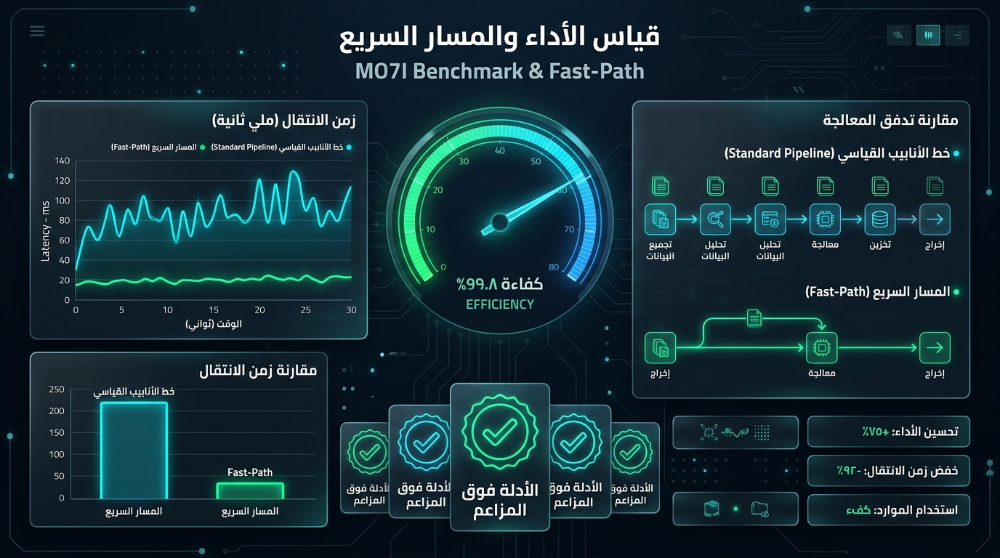
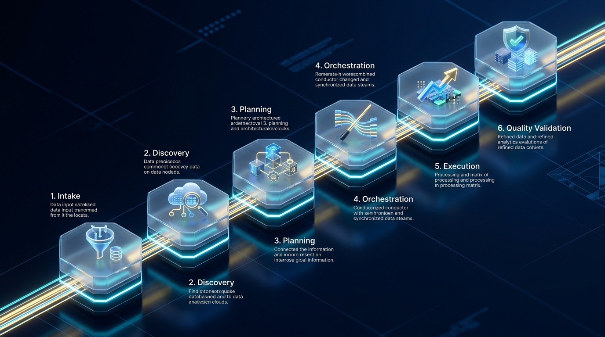
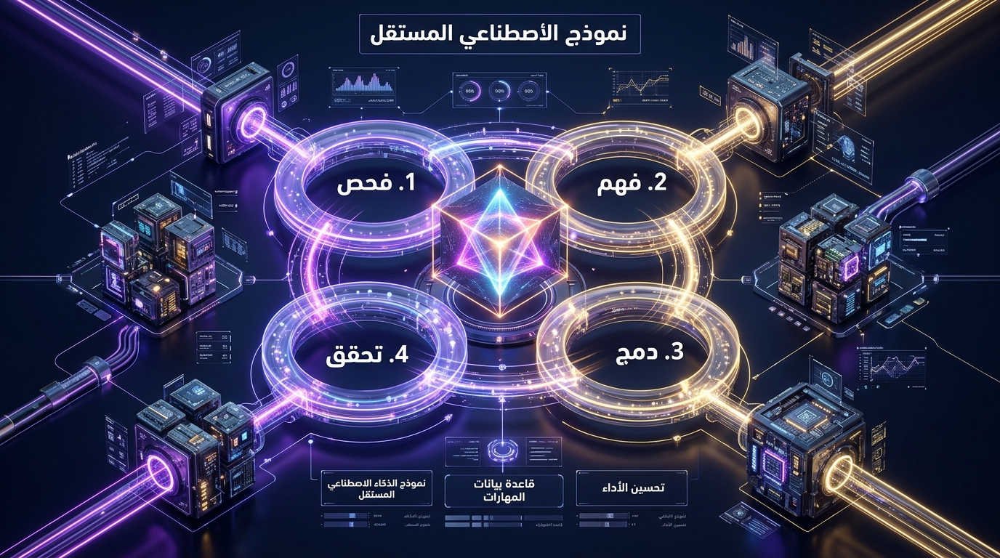
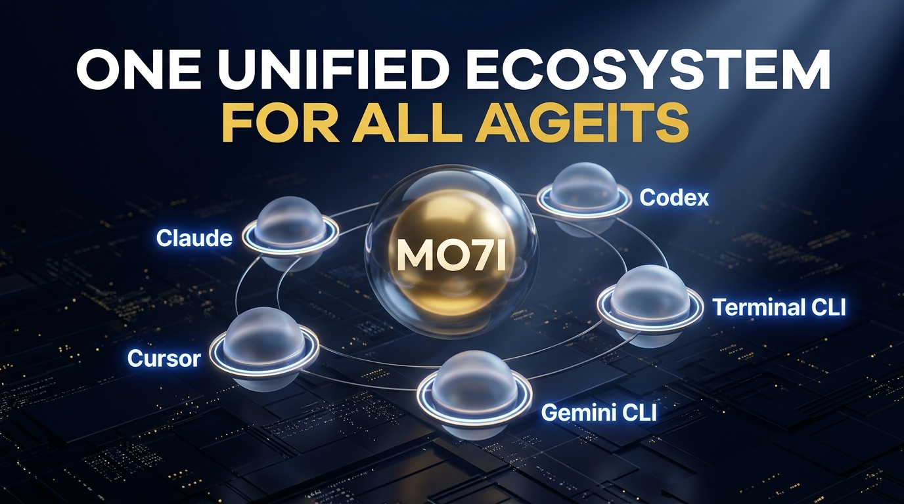

<div align="center">
  

  <br />

  [](CHANGELOG.md)
  [](LICENSE)
  [](package.json)
  [](docs/CROSS_PLATFORM_VERIFICATION.md)
  [](README.ar.md)

  <br />

  <h3>Universal Intelligence Layer, Autonomous Task Meta-Orchestrator & Official Slash Commands System</h3>
  <em>"The user specifies <strong>WHAT</strong> needs to be accomplished. MO7I determines <strong>HOW</strong> to accomplish it."</em>
</div>

---

A project onboarding and autonomous orchestration layer for AI agents: automatically detects the stack, provisions the right skills, tracks manual setup steps, selects the minimum skills per task, verifies with reproducible evidence, and logs every execution run. Consistent slash commands and unified state (`.mo7i/`) across projects and agent harnesses.

---

## ⚡ What's New in v2.6.0: Overhead Benchmarking, Platform Honesty & Publish Readiness

<div align="center">
  
</div>

<br />

Version 2.6.0 introduces quantifiable performance benchmarking, honest cross-platform verification, and pre-publish security hardening:

1. **Overhead Benchmark Suite (`/mo7i bench`)**: Measures execution overhead across 5 standard tasks (trivial edit, direct question, small feature, research task, multi-file refactor) comparing direct baseline versus orchestrated execution. Quantifies phases run, skills loaded, footprint bytes, and wall-clock latency with full results documented in [docs/BENCHMARK.md](docs/BENCHMARK.md).
2. **Fast-Path Bypass Analysis**: Documents an honest assessment of where orchestration adds unnecessary overhead (trivial single-variable edits and direct factual queries) and details the fast-path bypass mechanism that skips discovery/planning to reduce latency to near zero.
3. **Cross-Platform Verification Honesty**: Replaces assumptions with evidence-backed status labels. Only Universal Shell CLI (`bin/mo7i`) and Standard Agent Skills (`.agents/skills/`) are marked `VERIFIED`. Claude Code CLI is marked `UNVERIFIED` due to interactive browser login requirements, and phantom platform definitions have been eliminated. Full evidence report in [docs/CROSS_PLATFORM_VERIFICATION.md](docs/CROSS_PLATFORM_VERIFICATION.md).
4. **Platform Manual Verification Guides**: Includes step-by-step procedures (3 concise steps per platform) for developers wishing to manually verify slash command routing in Claude Code, Cursor, Codex, and Gemini CLI.
5. **Publish Readiness Audit**: Complete git history secret scan (`git log -p`) confirming zero credentials or private tokens leaked, validated [LICENSE](LICENSE), [SECURITY.md](SECURITY.md), and [CONTRIBUTING.md](CONTRIBUTING.md), and formalized pre-flight checklist in [docs/PUBLISH-CHECKLIST.md](docs/PUBLISH-CHECKLIST.md).

---

## 🔍 What's New in v2.5.0: Non-Next.js & Non-Code Validation

1. **Stack-Accurate Archetype Detection**: Automatically classifies Python/FastAPI, Rust, Go, and document-only folders as `Non-Technical / General Workspace`.
2. **Framework Leak Prevention**: Strictly prevents Next.js and frontend-only skills from leaking into backend or non-technical workspaces.
3. **Research Evidence Protocol & Verification**: Full enforcement of research evidence policy (minimum 3 searches, 2 fetched sources) and anti-hallucination validation ensuring all cited URLs were returned by tool executions.

---

## 🛠️ The Official Command Set

| Command | Usage | Description | Safety Profile |
| :--- | :--- | :--- | :--- |
| **`/mo7i`** | `/mo7i <task>` | Primary entry point to the 16-phase Universal Intelligence Meta-Orchestrator. | `Standard Execution` |
| **`/mo7i help`** | `/mo7i help` | Displays the complete catalog of commands, syntax, and examples. | `Read-Only` |
| **`/mo7i bench`** | `/mo7i bench [--json]` | Runs overhead benchmark suite across 5 standard tasks and updates documentation. | `Read-Only` |
| **`/mo7i setup`** | `/mo7i setup [mode]` | Provisions project-scoped skills (`initial`, `audit`, `update`, `repair`, `report`). | `Standard Execution` |
| **`/mo7i audit`** | `/mo7i audit` | Performs a read-only audit of project dependencies, installed skills, and drift. | `Read-Only` |
| **`/mo7i learn`** | `/mo7i learn [skill]` | Executes the 4-phase learning loop and records operational capability contracts. | `Standard Execution` |
| **`/mo7i discover`** | `/mo7i discover <query>` | Evaluates candidate specialists on skills.sh across 5 dimensions without auto-install. | `Read-Only` |
| **`/mo7i status`** | `/mo7i status [--json]` | Displays system release, active workspace, stack profile, and registry telemetry. | `Read-Only` |
| **`/mo7i doctor`** | `/mo7i doctor` | Validates Node.js runtimes, Skills CLI, command registrations, and script integrity. | `Read-Only` |
| **`/mo7i update`** | `/mo7i update [--dry-run]` | Detects new dependencies and synchronizes project skills with `.bak` backups. | `Human Gate Required` |
| **`/mo7i self-update`** | `/mo7i self-update [--check]` | Safely updates MO7I skills with semver comparison, backup, and rollback. | `Human Gate Required` |
| **`/mo7i selftest`** | `/mo7i selftest` | Black-box independent verification of installed skill in a temp project. | `Read-Only` |

---

## 🔄 The Integrated Autonomous Execution Lifecycle

<div align="center">
  
</div>

<br />

The 16-phase lifecycle ensures rigorous, automated execution from requirement deconstruction to verified output:

1. **INTAKE**: Deconstruct user goals or slash command parameters.
2. **PROJECT DETECTION**: Identify project root, git repository boundaries, and environment runtimes.
3. **PROJECT PROFILE INSPECTION**: Audit `.mo7i/project-profile.json` and `.mo7i/skill-registry.json`.
4. **SETUP STATUS CHECK**: Determine whether the project is uninitialized or missing foundational skills.
5. **PROJECT SKILL SETUP (WHEN NEEDED)**: Invoke `mo7i-project-setup` to provision project-scoped skills into `./.agents/skills/`.
6. **TASK CLASSIFICATION**: Categorize immediate task into one of 13 functional domains.
7. **CAPABILITY GAP ANALYSIS**: Determine whether project skills suffice or external specialists are required.
8. **SKILL DISCOVERY**: Discover candidate skills via Vercel Labs `find-skills` (`npx skills find "<keywords>"`).
9. **SKILL LEARNING**: Execute the 4-phase learning loop (Inspect -> Understand -> Integrate -> Validate).
10. **COMPATIBILITY & PLANNING**: Verify candidate skills do not conflict and construct phased roadmap.
11. **SKILL ORCHESTRATION**: Sequence specialist skills across pipeline stages, minimizing context bloat.
12. **EXECUTION**: Implement changes adhering to domain best practices and execute tool commands.
13. **QUALITY VALIDATION**: Run test suites, compilers, and linters ("evidence over claims").
14. **KNOWLEDGE & PROFILE UPDATE**: Record operational insights in memory and update project profile telemetry.
15. **SAFE CLEANUP**: Prune transient task skills while strictly preserving project foundational skills.
16. **FINAL REPORT**: Deliver structured final report citing verified outputs and standardized status labels.

---

## 🧠 Skill Learning Engine (Dynamic Discovery & Validation)

<div align="center">
  
</div>

<br />

MO7I uses a disciplined 4-phase learning loop before any external specialist skill is promoted into the active project registry:
- **1. Inspect (`فحص`)**: Strict security scanning, dependency auditing, and scope verification.
- **2. Understand (`فهم`)**: Contract extraction, trigger preconditions, and input/output parameter schemas.
- **3. Integrate (`دمج`)**: Seamless registration within `./.agents/skills/` without framework pollution.
- **4. Validate (`تحقق`)**: Isolated execution testing to verify the skill actually solves target problems before promotion.

---

## 🌐 One Unified Ecosystem For All Agents

<div align="center">
  
</div>

<br />

MO7I strictly distinguishes between verified and unverified platforms based on reproducible automated command output:

| Platform | Native Location | Registration Mechanism | Verification Status | Notes / Raw Evidence |
| :--- | :--- | :--- | :--- | :--- |
| **Universal Shell & CLI** | `bin/mo7i`, `bin/setup-project-skills` | Executable Node.js binary CLI | **`VERIFIED`** | Direct CLI invocation tests pass end-to-end; writes real run logs to `.mo7i/runs/` |
| **Standard Agent Skills** | `.agents/skills/mo7i/` | Standard skill specification (`SKILL.md`) | **`VERIFIED`** | Independent black-box selftest passes against installed skill footprint |
| **Claude Code CLI** | `.claude/commands/mo7i.md` | Slash command markdown files | **`UNVERIFIED`** | CLI is installed (`v2.1.325`), but returns `Not logged in · Please run /login` in non-interactive runtimes |
| **Cursor / Windsurf** | `.cursor/rules/mo7i-commands.mdc` | MDC instruction rules | **`UNVERIFIED`** | Editor rules provide prompt instructions; Cursor has no documented custom slash command parser |
| **OpenAI Codex** | `.codex/prompts/mo7i.md` | Prompt command files | **`UNVERIFIED`** | No documented slash command discovery standard in upstream Codex specifications |
| **Gemini CLI** | `.gemini/commands/mo7i.toml` | Extension command definitions | **`UNVERIFIED`** | No documented slash command discovery standard in upstream Gemini specifications |

---

## 📋 How to Verify Platforms Manually (3 Steps Each)

For human operators running interactive sessions with full UI access:

### Claude Code CLI
1. Log in interactively by running `claude` and completing `/login` in your browser.
2. In your repo root, run `./bin/mo7i setup` to link command definitions into `.claude/commands/`.
3. Launch `claude` and invoke `/mo7i doctor` to verify auto-completion and command execution.

### Cursor / Windsurf IDE
1. Open the project root in Cursor.
2. Verify `.cursor/rules/mo7i-commands.mdc` is indexed in project rules.
3. Open Cursor Chat (`Cmd+L` / `Ctrl+L`) and trigger: *"Execute /mo7i doctor"* to verify the assistant follows the MDC rule.

### OpenAI Codex
1. Verify `.codex/prompts/mo7i.md` is present in the workspace.
2. Start an interactive session with the Codex CLI.
3. Query the assistant on MO7I capabilities and confirm prompt instructions are loaded.

### Gemini CLI
1. Verify `.gemini/commands/mo7i.toml` is present in the workspace.
2. Launch Gemini CLI with active credentials.
3. Trigger the extension command and verify output.

---

## 🚀 Installation & Usage

Install using the Skills CLI (`npx skills`) or run directly via Node.js / npx. MO7I ships with a lean package footprint (~75 KB) containing only `SKILL.md` and `references/`:

### Agent Skills & Project Scope (Recommended)
```bash
# Add main MO7I orchestrator
npx skills add Sayedmo7i/MO7I-Universal-Intelligence --skill mo7i -y

# Optional: Add project setup companion
npx skills add Sayedmo7i/MO7I-Universal-Intelligence --skill mo7i-project-setup -y
```

### Direct Project Bootstrapping via `$mo7i`
Once `$mo7i` is installed, you can trigger project-scoped skill initialization directly without installing a separate command:
```bash
/mo7i setup initial      # Analyzes stack and provisions recommended skills
/mo7i setup audit        # Read-only audit of project skills and companion health
```

### CLI & Script Execution
```bash
# Display help and commands catalog
./bin/mo7i help

# Execute performance benchmark
./bin/mo7i bench

# Execute a universal engineering task
./bin/mo7i "Build a responsive REST API"

# Run project setup in initial mode
./bin/setup-project-skills initial

# Audit project dependencies and skills
./bin/mo7i audit

# Run system doctor diagnostics (JSON or formatted text)
./bin/mo7i doctor --json

# Check system status and post-install setups
./bin/mo7i status --json

# Run independent black-box verification
./bin/mo7i selftest
```

---

## 📚 Reference Documentation Index

- [Benchmark & Overhead Report](docs/BENCHMARK.md): 5-task benchmark results, fast-path analysis, and latency metrics.
- [Cross-Platform Verification](docs/CROSS_PLATFORM_VERIFICATION.md): Audit results, raw evidence, and verification procedures.
- [Pre-Publish Checklist](docs/PUBLISH-CHECKLIST.md): Security scan results, pre-flight gates, and release guide.
- [Slash Commands Reference](references/slash-commands.md): Architecture, command specs, parameter schemas, and platform guides.
- [Project Intelligence & Setup](references/project-intelligence.md): Technical analysis engine, Matt Pocock collection, registry schemas.
- [Universal Task Domains](references/task-domains.md): Functional domain taxonomy, missing-service handling.
- [Autonomous Orchestration](references/orchestration.md): 16-phase lifecycle, multi-skill sequencing, precedence.
- [Skill Learning Engine](references/skill-learning-engine.md): 4-phase learning loop, 6 skill states, profile schemas.
- [Skill Discovery](references/skill-discovery.md): `find-skills` workflow, 5-dimension scoring rubric.
- [Skill Lifecycle](references/skill-lifecycle.md): Registry tracking, atomic writes, safe cleanup.
- [Preferences & Memory](references/preferences.md): Cross-project storage, observed vs confirmed preferences.
- [Model Selection](references/model-selection.md): Workload complexity matching, delegation rules.
- [Security & Human Gates](references/security-policy.md): Threat vectors, human gates, zero-secret policy.
- [Execution & Verification](references/execution-and-verification.md): Acceptance criteria, evidence standards.
- [Domain Glossary](GLOSSARY.md): Formal terminology standards and avoidance rules.
- [Agent Setup & Operations](AGENTS.md): Task tracking, triage labels, and domain doc guidelines.

---

## 🤝 Contributing & License

Contributions are welcome! Please review [CONTRIBUTING.md](CONTRIBUTING.md) and [SECURITY.md](SECURITY.md) before submitting pull requests.

Licensed under the [MIT License](LICENSE).
